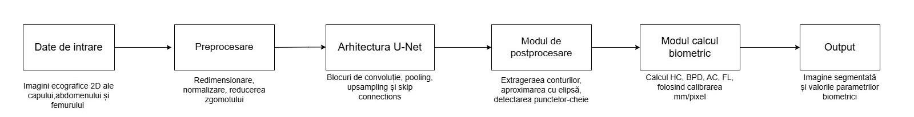

# <ins>Măsurarea Automată a Parametrilor Biometrici Fetali</ins>

## Descrierea proiectului

&emsp;&emsp;Scopul acestui proiect este crearea unei aplicații care să automatizeze procesul de măsurare a parametrilor biometrici ai fătului pe baza imaginilor cu ecografie utilizând algoritmi de învățare profundă și de procesare a imaginilor.

&emsp;&emsp;Parametrii biometrici care urmează să fie măsurați sunt:
- HC - Circumferința capului fătului
- BPD - Diametrul biparietal
- AC - Circumferința abdominală a fătului
- FL - Lungimea femurului

&emsp;&emsp;Rolul proiectului este de a automatiza procedura de măsurare și obținerea unor rezultate care pot să fie reproduse.

## Analiza literaturii de specialitate

&emsp;&emsp;În vederea documentării și analizării tematicii proiectului am selectat cinci articole care cuprind informații relevante legate de aplicarea metodelor de învățare profundă în analiza imaginilor cu ecografii ale fătului.

| Nr | Autori(i)/An | Titlul articolului | Aplicație/ Domeniu | Tehnologii utilizate | Metodologie | Rezultate | Limitări | Comentarii suplimentare |
|---|---|---|---|---|---|---|---|---|
| 1 | Szymon P lotka Adam Klasa Aneta Lisowska Joanna Seliga-Siwecka Micha l Lipa Tomasz Trzci´nski Arkadiusz Sitek 2022 0 | Deep Learning Fetal Ultrasound Video Model Match Human Observers in Biometric Measurements | Imagistică, medicală, ecografie obstetricală. | CNN multitask de tip U-Net, cu ConvLSTM în bottleneck pentru informația temporală, attention gates, deep supervision și hărți de trăsături multi-scală. | 700 de videoclipuri de la sarcini cuprinse între 15-38 de săptămâni, cu split 80% antrenare- 20% trestare. S-au ales cadre cu scor de clasificare >0.9 pentru plan standard, iar cel mai bun cadru s-a ales printr-o medie ponderată (scor, măsurătoare, congruența elipsei) | Comparativ cu alte CNN-uri: IoU 0.905, Dice 0.962, acuratețe 0.975 și F1 0.96. Eroare de măsurare: HC 2.9mm, AC 3.8 mm, FL 0.8mm (sub pragul clinic de approx 15%) Concordanță (ICC): 0.96-0.98 între observatori. Estimări: eroare de 0.05 săptămâni pentru vârstă și 25g pentru greutate. Viteză: approx o secundă | Date de la un singur producător de aparate (GE) și o singură instituție, deci generalizarea este incertă. Fiecare imagine de antrenare a fost adnotată de un singur specialist, iar adevărul de referință este subiectiv.Apar erori în cazuri cu umbre sau mișcare. GA șigreutatea nu se calculează dacă lipsește unul dintre cele 3 planuri standard. | Este prima lucrare care compară un model deep learning cu sonografiști pe videoclipuri ecografice complete, nu pe cadre izolate. Programele existente sunt semi-automate și cer operatorului să aleagă cadrul corect în timp ce FUVAI îl alege singur. |
| 2 | Cesar Diaz-Parga, Marta Nunez-Garcia, Maria J. Carreira, Gabriel Bernardino, and Nicolas Vila-Blanco 14 ianuarie 2026 | AGE-US: automated gestational age estimation based on fetal ultrasound images | Imagistică medicală și obstetrică. Estimare automată a vârstei gestaționale din trimestrul III, prin măsurători biometrice, HC, AC, FL, BPD | Deep learning, U-Net, transfer learning, hărți de distanță pentru femur, algoritmul Watershed, ellipse fitting, ecuatia Hadlock cu 4 parametri | Pipeline în 3 pași care au scopul de a imita practica clinică. Segmentarea capui și abdomenului, localizarea capetelor femurului prin utilizarea unei hartă de distanță, calul GA prin aplicarea ecuatiei Hadlock. DataSet: IMPACT(114 studii). | GA, MAE=0.76 săptămâni și MAPE=2.3%. Erori procentuale la HC,BPD și AC sunt sub variabilitatea inter-observator(4.9%-11%). Encoderul comun reduce parametrii cu 25% fără diferențe semnificative. | AC are cea mai mare eroare, 1.207 cm, aspect ce este cauzat de contrastul scăzut la limitele abdomenului. FL are MAPE=5.4% peste intervalul inter-observator, din cauză că structura este mică și punctele sunt pe diafază. SET DE DATE MIC | Cod și greutăți publice pe GitLab CiTIUS. Este mai interpretabilă decât metodele end-to-end precum DeepGA. |
| 3 | Szymon Płotka, Michal K. Grzeszczyk, Robert Brawura-Biskupski-Samaha, Paweł Gutaj , Michał Lipa, Tomasz Trzciński , Ivana Išgum , Clara I. Sánchez, Arkadiusz Sitek | BabyNet++: Fetal birth weight prediction using biometry multimodal data acquired less than 24 hours before delivery | Imagistică, medicală, ecografie obstetrică, medicină perinatală | Rețea hibridă CNN+ Transformer, bazată pe 3D ResNet-18, în care ultimele două module reziduale sunt înlocuite cu Residual Transformer Module (RTM) cu atenție multi-head 3D ăi codare pozițională temporală | 194 paciente din 4 centre, cu 582 de videoclipuri (3 per parcientă cu 134.264 de cadre) de la aparate GE. Adevărul de referință este greutatea reală la naștere.Videoclipurile sunt împărțite în segmente de 16 cadre (128x128), iar predicția finală este media predicțiilor segmentelor. | Față de clinicieni: MAE 179 \~ 19f față de 188 \~ 24g, MAPE 5.1% față de 5.4%. A fost mai bun în 3 din 4 centre, iar în centrul A diferența nu a fost semnificativă (p=0.09). Față de alte metodeȘ a fost cel mai bun din comparație (DAFT 201g, BabyNet 285g, 3D ResNet-18 302g, ViViT 390g). Ablație: adăugarea modulului DAFT aduce cel mai mare câștig (MAEde la 302g la 198g), iar combinația RTM+DAFT dă cel mai bun rezultat. Părți fetale: videoclipurile cu abdomenul singur dau 175 \~ 17g, aproape la fel de bine ca toate cele trei părți. | Set de date mic (194 de paciente) și test pe doar 38. Un singur producător de aparate (GE), doar sarcini cu făt unic și doar paciente caucaziene. Erori mai mari la greutăți extreme (sub 2500g și peste 4000g), pentru că aceste cazuri sunt rare în date. | Este prima metodă care prezice greutatea fetală la naștere. Extinde modelul anterior BabyNet, care folosea doar imagini. Nu depinde de un plan standard perfect, ceea ce contează aproape de naștere, când imaginile sunt mai greu de obținut. Este gândit ca instrument de sprijin pentru clinicienii mai puțin experimentați, nu ca înlocuitor, și poate ajuta la alegerea tipului de naștere. |
| 4 | Płotka, S.S. / 2024 | Enhancing prenatal care through deep learning | Imagistică medicală prenatală: ecografie fetală și chirurgie fetoscopică. | Ecografii video(GE Healthcare),CNN,Tranformers, modul DAFT(Dynamic Affine Feature Map Transform) pentru date clinice. | Analiză video 2D+t, multi-task: detectarea planurilor standard și măsurarea HC, BPD, AC, FL; fuziune imagine + date clinice | Măsurători comparabile cu ale medicilor experți; estimarea greutății din abdomen fără diferență semnificative față de metoda manuală. | Date care provin din partea unui singur producător și doar de la o populație; utilizează doar sarcini speciale, sănătoase și se observă lipsa de explicabilitate a unor modele. | Relevant pentru proiect fiind util pentru automatizrea analizelor medicale. Ar putea să fie îmbunătățit prin extragerea datelor din mai multe centre și dispozitive, hărți de atenție(Grad-CAM) care au rolul de verificare a măsurătorilor. |
| 5 | Hyunwoo Cho , Dongju Kim , Sunyeob Chang , Jinbum Kang , Yangmo Yoo | A system-on-chip solution for deep learning-based automatic fetal biometric measurement | Medicină prenatală - măsurători biometrice automate din ecografii fetale. | Rețea de segmentare H-BiSeNet, Deep Learning, CNN, TensorFlow, Vitis AI, System-on-Chip(SoC) Xilinx Zynq UltraScale+(DPU + APU) | Segmentare capului, abdomenului și femurului cu o singură rețea, apoi măsurate prin elipsa(HC, AC) și puncte cheie (BPD,FL) folosind H-BiSetNet. | Segmentare mai precisă decât cea făcută folosind arhitectura U-Net și DeepLabv3+, cu un model mult mai mic; Corelație ridicată cu măsurătorile manuale r:= 0.983ș procesare de 4,25 FPS pe SoC care este de aproximativ 10 ori mai rapidă decât doar pe procesor. | Resurse hardware limitate, viteza este mai mică decât cea de achizițe a ecografului. Formula aproximativă pentru circumferință poate să introducă erori. Nu se utilizează video ci imagini statice. | Soluție potrivită pentru ecografii portabile, însă poate fi îmbunătățită prin creșterea vitezei și testarea pe date mai diverse. |

&emsp;&emsp;Pe baza literaturii analizate mai sus propunem aplicarea algoritmului de segmentare a structurilor fătului prin utilizarea arhitecturii U-Net și apoi calcularea parametrilor biometrici prin algoritmi de procesare a imaginilor

&emsp;&emsp;Această arhitectură permite identificarea structurilor anatomice prin combinarea caracteristicilor generale ale imaginii cu detaliile spațiale de care este nevoie pentru delimitarea contururilor.

&emsp;&emsp;Alegerea U-Net este motivată de simplitatea relativă a implementării, disponibilitatea soluțiilor deja existente și open-source, dar și posibilitatea adaptării modelului la imaginile ecografice fetale.

## Componente principale:

&emsp;&emsp;Soluția propusă este organizată modular, fiecare componentă având un rol specific în procesarea imaginilor și calcularea parametrilor necesari proiectului.

1. Date de intrare: 
   Imagini ecografice 2D ale capului, abdomenului și femurului fetal achiziționate în timpul examinării prenatale.
2. Preprocesare: 
   Pregătește imaginile prin redimensionare, normalizarea intensității pixelilor și reducerea zgomotului pentru a avea date uniforme.
3. Arhitectura U-Net: 
   Rețea neuronală convoluțională pentru segmentare, este formată dintr-un encoder și un decoder care sunt legate între ele prin skip-connections. Encoder-ul extrage caracteristicile extrase la nivelul cel mai profund al rețelei. Decoder-ul reconstruiește informația spațială prin operații de upsampling și convoluție. Skip-connections-urile transferă informațiile între encoder și decoder pentru păstrarea detaliilor necesare segmentării. Bottleneck-ul
4. Postprocesare: 
   Extrage contururile structurilor, le aproximează prin elipse și detectează punctele cheie precum: capetele femurului sau extremitățile diametrului biparietal.
5. Modul calcul biometric: 
   Calculează parametrii HC, BPD, AC și FL pe baza elipselor și a punctelor cheie folosindu-se de factorul de calibrare mm/pixel cu scopul de a transforma distanțele din pixeli în milimetri.
6. Output: 
   Imaginea segmentată cu structurile evidențiate și valorile numerice ale parametrilor biometrici utile pentru estimarea vârstei gestaționale și a greutății fetale.

## Tehnologii propuse:

&emsp;&emsp;Pentru dezvoltarea aplicației ne propunem să folosim următoarele:

&emsp;&emsp;1. Python - limbajul principal de programare; 
&emsp;&emsp;2. PyTorch - are rolul de a implementa și antrena modelul U-Net; 
&emsp;&emsp;3. OpenCV - pentru preprocesare și postprocesare a imaginilor; 
&emsp;&emsp;4. NumPy - pentru calculul numeric; 
&emsp;&emsp;5. Streamlit - pentru dezvoltarea unei interfețe grafice ușor de folosit care va avea rolul de a încărca imaginile și de a obține rezultatele. 
